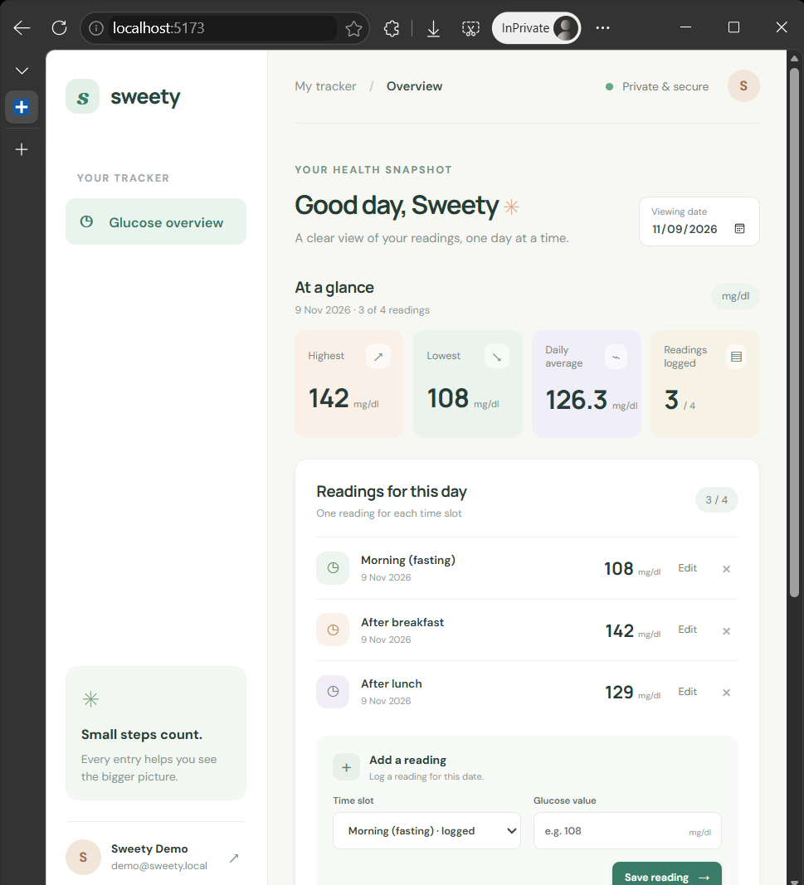

# Sweety — Blood Glucose Tracker

A local take-home project for recording daily blood glucose readings and reviewing daily, month-to-date, and previous-month reports. Built with React, Express, and PostgreSQL.

## Run locally without installing PostgreSQL

1. Copy `.env.example` to `.env` and set a unique `JWT_SECRET` (at least 24 characters) and a demo password.
2. Keep `DATABASE_URL=pglite://./.data/sweety` for embedded PostgreSQL with persistent local files.
3. From the repository root run `npm install`, then `npm run migrate` and `npm run seed`.
4. Start both app processes with `npm run dev`.
5. Visit <http://localhost:5173> and sign in using `DEMO_USER_EMAIL` and `DEMO_USER_PASSWORD` from `.env`.

The embedded database files are stored under `.data/` in the project directory. This mode uses [PGlite](https://pglite.dev/), an embedded PostgreSQL build. Docker and standard `postgres://` URLs continue to use a PostgreSQL server.

## Requirements for standalone PostgreSQL

- Node.js 20.14 or newer (Node 22/24 LTS recommended)
- npm
- PostgreSQL 16 or newer, or Docker Desktop with its engine running

## Run locally with PostgreSQL

1. Copy `.env.example` to `.env` and set a unique `JWT_SECRET` (at least 24 characters), PostgreSQL connection values, and a demo password.
2. Create an empty PostgreSQL database named `sweety` (or update `DATABASE_URL` in `.env`).
3. From the repository root run `npm install`, then `npm run migrate` and `npm run seed`.
4. Start both app processes with `npm run dev`.
5. Visit <http://localhost:5173>. The demo account uses the email and password configured as `DEMO_USER_EMAIL` and `DEMO_USER_PASSWORD` in `.env`.

The API listens on port 4000 by default. Set `API_PORT`, `CLIENT_ORIGIN`, and `APP_TIMEZONE` in `.env` when changing local ports or timezone.

## Run with Docker Compose

Make sure Docker Desktop is running, then copy `.env.example` to `.env`, set `JWT_SECRET` and `DEMO_USER_PASSWORD`, and run:

```sh
docker compose up --build
```

The Compose configuration starts PostgreSQL, applies the schema migration, seeds a local demo user, and serves the web app at <http://localhost:8080>. Data is kept in the `postgres_data` volume. For a clean local reset, stop Compose and remove that volume with `docker compose down -v`.

## Database, tests, and build

```sh
npm run migrate  # create the schema
npm run seed     # add demo user and sample readings (safe to rerun)
npm test         # run server domain tests
npm run build    # build the React client
```

The demo seed includes sample values for today so the reports can be explored immediately. Do not use demo credentials or sample readings for real health information.

## Features

- Email/password registration and login; password hashes use bcrypt. Authentication is held in an HttpOnly, SameSite cookie.
- User-scoped CRUD for glucose readings, with database and API validation for 40–600 mg/dl, whole numbers, no future dates, unique daily slots, and no more than four readings per day.
- Daily, month-to-date, and complete previous-calendar-month summaries: highest, lowest, average rounded to one decimal place, and reading count. Daily includes its readings.
- Responsive UI with inline validation feedback, empty states, edit and delete actions.

## Notes and assumptions

- Dates are calendar dates in `APP_TIMEZONE`; the default is `Asia/Kolkata`. A report's “previous month” means the full calendar month before the selected date's month. Month-to-date ends on the selected date.
- Updating a reading is allowed to retain the same day and slot; conflicts with a different reading in that slot are rejected.
- The app records readings and displays arithmetic summaries. It does not interpret results or provide medical advice.
- Docker Compose and standard PostgreSQL connection support are included for running against a full PostgreSQL server.
- With more time: add browser-based UI tests and an accessibility review.

## Screenshots / walkthrough

Dashboard preview:



A 1:31 walkthrough recording is available in `screenshots/sweety-walkthrough.mp4` (kept outside GitHub because it exceeds GitHub's 100 MB file limit).
